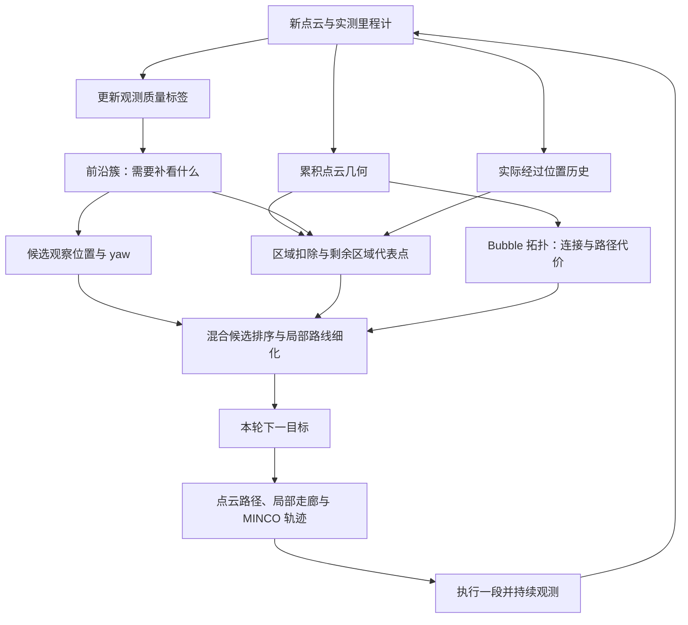

# Coverage 如何在点云探索中形成完整任务闭环

核对日期：2026-10-09。范围为组合式 `planner_runtime_node` 的原生 EPICON coverage
分支，依据当前工作树源码与 release 配置进行静态分析；本文的房间示例用于解释流程，
不是运行实验结果。目标探索与共享地图总体架构见
[当前探索框架与 MapManager 协作](exploration_map_manager_current.md)。

## 1. Coverage 的含义与实际载体

当前 coverage 的任务是：在给定区域内持续寻找有价值的观察位置，飞过去获取新点云，
逐步减少观测不足的前沿和几何推断出的待探索区域，直到完成审计或受阻退出。

它没有先生成一条扫描整个区域的固定航线，也没有给每个原始点添加一个 coverage 字段。
Coverage 策略通过前沿标签、历史经过位置、剩余区域代表点和访问顺序进入探索决策。
点云提供几何证据，实际运动提供历史，二者共同决定下一步观察任务。

| 数据 | 保存在哪里 | 回答的问题 |
| --- | --- | --- |
| 累积点云 P | 原生 `LIOInterface` 的 ikd-tree | 已经测到的物体表面在哪里，附近净空多大？ |
| 三维 cell 观测标签 L | `FrontierData::label_map_` | 哪些表面已经处理，哪些仍因距离/方向而需要补看？ |
| 前沿簇 F | `FrontierManager::cluster_list_` | 哪一组观测不足的表面可作为同一个观察任务？ |
| 实际经过位置 H | `EpiconFrontend::new_path` → `RegionNode::traj_point` | 机器人确实经过哪里，可近似扣除哪些区域？ |
| Bubble 图 G 与稀疏历史节点 | 原生 `TopoGraph` | 两个候选是否连接，绕障路径多长？ |
| 未知区域代表点 U | `EpiconFrontend::Impl::unknown` | 本轮更新区域中哪些剩余部分值得引导探索？ |
| 访问意图 T、当前目标与失败冷却 | `global_tour_`、`next_goal_node_`、`deferred` | 接下来先去哪，哪些失败位置暂时跳过？ |

`RegionNode::traj_point` 与 `history_odom_nodes_` 不是同一集合。前者是实际路径位置样本，
后者是稀疏拓扑历史节点；“历史节点超过 10 个才加入未知引导”指后者，不是收到 10 帧
点云就启用。

## 2. 数据闭环



图中的两条任务信息来源分工不同：F 促使机器人把已经出现、但没有看好的表面补看清；
U 让路线考虑区域中仍可能需要探索的剩余部分。它们在 T 中变成先后顺序，最终通过
真实运动改变后续 P、L、F 和 H。

## 3. 任务启动：确认区域与模式，保留地图历史

任务区域来自配置的 box，或启用时由动态选框提供。Supervisor 发布带 `task_id`、
`task_epoch`、`mission_mode=MODE_COVERAGE` 的请求，探索 FSM 将 mission 切为 coverage。
`usingEpicon()` 在非 target 模式下选择原生 EPICON。

`startExplorationTask()` 清理旧目标、访问顺序、失败冷却和完成验证状态，启动全局路径
定时器，并进入 `PLAN_TRAJ`。`EpiconFrontend::resetTask()` 没有清空点云、前沿标签、
region 历史和 Bubble 图。因此新任务可以复用已经积累的感知历史，而不会自动重飞所有
以前观察过的位置。执行还要求新鲜里程计、点云以及机器人接入拓扑成功。

当前组合入口以 `native_coverage=true` 初始化旧探索管理器，因而不创建旧
`CoverageGuidanceManager`。配置里的 `coverage_guidance/mode=off` 关闭的是那套旧引导，
不能据此判断原生 coverage 任务关闭；实际分支由 mission 和 FSM 决定。

## 4. 每帧点云：同时更新几何、观测质量和实测路径

`GlobalMapRuntime` 接收配对 cloud/odom。原生 coverage 活跃时先分发给探索 FSM，再
维护共享世界地图。`EpiconFrontend::ingestCloud()` 内部完成三个任务：

1. 更新原生点云地图。`sim_lio.cpp` 对输入点云做 0.1 m 降采样后写入 ikd-tree，提供
   最近点距离、近邻和包围盒搜索。输入是已配准的点云，这段代码不重新进行 SLAM。
2. 更新 frontier 簇。点云投影和近几帧信息帮助判断视野边缘、深度间隙和观测距离，
   再更新稀疏三维标签。
3. 记录实际位置。与上一个样本距离达到 `sample_traj_point` 时保存位置，当前配置为
   0.1 m；这些位置随后归入所在 region。规划轨迹中的未来点不充当已经经过的证据。

Coverage 在此处开始形成记忆，但没有把“新测到的点数”直接当作覆盖百分比。

## 5. 前沿：把“没有看好”转换为可以补看的任务

原生标签为 `DENSE/SPARSE/UNKNOWN/FRONTIER_DIS/FRONTIER_DIR`。

- `DENSE` 表示该表面 cell 已按当前规则处理，不再要求继续补看；部分噪声剔除也写入
  这个标签，所以它不是自由空间，也不是每个 cell 都经过独立质量认证。
- `SPARSE` 表示尚未被判为充分处理的表面 cell。
- `FRONTIER_DIS` 与 `FRONTIER_DIR` 分别对应距离、方向/视野等原因的观测不足。
- `UNKNOWN` 在这张稀疏标签表里主要表示没有条目，不等价于 ROG 三态占据中的 UNKNOWN。

有效前沿不是“任意没点的地方”。代码先找到观测不足的表面，再选出邻接 DENSE 的
SPARSE cell 作为前沿；聚类同时考虑空间距离和局部法向方向。

飞到较好的位置后，新扫描可能使原 frontier cell 变成 DENSE；重聚类时它不再属于
待观察簇。与此同时，新视角还可能暴露更深处的新前沿。因此前沿数不一定单调下降，
到达视点也不是直接给区域完成状态盖章。

## 6. 视点：决定从哪里、以什么朝向观察

普通一轮按历史拓扑距离选择有限近邻簇，完整审计时扩大到全部有效簇。每个簇的流程为：

```text
簇中心周围柱形采样
  → 任务边界、点云净空与 region 检查
  → 候选分组并接入 Bubble 图，过滤不可达组
  → 距离、观测方向、遮挡和视野检查
  → 每个候选枚举 yaw，统计可见前沿数量
  → 选出该簇一个代表视点
```

原生默认每簇约 480 个初始位置（5 高度 × 6 半径 × 16 周向），初始点云净空门槛
直接写为 0.9 m；每个位置枚举 8 个 yaw。分数来自可见前沿数，目标是选择能够补看该
簇的位置，不是让轨迹经过簇内全部表面点。

注意两个步骤不同：先在簇内选择代表视点，再在簇间/未知区域点之间决定访问顺序。
当前原生全局路径代价主要由拓扑路径长度和高度变化得到，不能把旧前端的十余个评分项
直接套到这里。原生参数从 `epicon/` 读取，父命名空间旧 frontier 配置不一定生效。

## 7. 未知区域：用走过的位置和点云构造剩余空间近似

这是 coverage 长程意图的重要来源。原生默认按 5 × 5 × 4 m 分 region，实际更新集合
来自本帧点云落点及从机器人到这些 region 的沿途区域，再应用更新预算。不是每轮对
整个任务 box 里的所有未知空间进行全量分析。

对本轮 region R：

1. 检查输入的有效前沿簇包围盒是否与 R 相交。没有满足条件的前沿时，设置
   `is_finished=true`，该 region 本轮不输出未知代表点。
2. 取 R 中历史实际经过的位置 p。
3. 查询 p 到最近点云的距离 `d_occ`，以及到与 R 相交的前沿簇包围盒中心的最小距离
   `d_frontier`，令 `r=min(d_occ,d_frontier)`。
4. r 达到阈值时生成轴对齐盒 `B(p)=[p-r,p+r]`，从 R 中逐个扣除。
5. 按片段大小阈值保留剩余盒，依据共享面关系聚类；每个连通分量的盒中心加权平均，
   形成未知引导点 u。

概念上可以写为：

```text
本轮待探索空间近似 U_R ≈ R \ union(B(p)), p 为 R 中的实测历史位置
未知引导点 = U_R 中各剩余连通分量的代表中心
```

`d_frontier` 限制扣除范围，使近处尚未看好的前沿能保留探索需求；`d_occ` 让扣除尺度
随周围障碍几何变化。随着实际运动和新点云增加，历史位置、距离、前沿分布均会改变，
所以剩余形状和代表点也会重新计算。

上述是几何启发式，不是可见体积积分：它没有逐条证明盒内位置被传感器看过，盒角还
可能超出最近障碍距离球。片段大小采用 0.4 m 的各轴离散计数，不是读取占据体素数量。
`is_finished` 也只是基于前沿的 region 筛选标签，不能当作任务完成的独立证明。

此外，`unknown` 输出在更新时清空并从本轮更新区域重建；历史点云、标签和路径是
持久的，但这里没有一张“所有未知连通分量均有稳定 ID”的完整全局任务账本。

## 8. Coverage 怎样真正改变下一目标

两个直接接入点都在前端路线决策中。

### 8.1 视点与未知点组成混合候选

历史拓扑里程计节点超过 10 个后，unknown 代表点被包装为 `is_unkownpoint_` 节点，
与 `is_viewpoint_` 的普通视点共同参与规划。未知点先尝试接图；接入失败时，代码会尝试
朝附近历史节点方向移动代表点以寻找可连接位置，仍失败则去掉。处理后的目标不一定
仍位于原始剩余区域质心。

随后从混合集合选取欧氏距离较近的最多 20 个节点，计算拓扑路径代价，运行 LKH 排序。
未知相关代价带 `unknown_penalty_factor`，当前配置为 1.5。首行到未知节点的代价还有
重复乘因子的实现细节，不能将全部边解释成统一的一次惩罚。

结果可理解成一条本轮访问意图：

```text
当前位置 → 补看侧面 V1 → 补看门口 V2 → 向剩余区域 U1 继续
```

这个示例表示候选次序，不是已经验证可直接连线飞行的完整轨迹。LKH 也只优化当前候选池，
不是把整个世界的全部点都放进一次覆盖规划。

### 8.2 后续未知节点作为局部路线出口

遍历排序结果时，普通视点进入局部序列；满足条件的较早未知节点也可能直接进入序列。
已有至少两个局部节点后遇到的较远未知节点成为 `next_grid_node`，作为本轮后续出口。

`refineLocalTourHGrid()` 构造当前位置、局部候选和出口之间的代价图，用 Dijkstra
选到出口的路径。出口改变了局部目标的选择：机器人会考虑“完成眼前观察后往哪里继续”。

该步骤允许只经过部分候选，没有“必须访问全部局部视点”的约束。所以最终顺序可能
比 LKH 顺序短；不能宣称它给每个前沿都分配了必达航点。active-region 点虽然被计算，
加入主候选池的语句目前被注释。

## 9. 执行：每次落实下一目标的一段轨迹

`updateGoalNode()` 取 `global_tour_[1]` 为下一目标。FSM 调用
`planExploreTraj(..., route={}, observation={}, coverage={}, pointcloud_frontend=true)`。
这些空上下文说明：此入口没有将旧覆盖观测球、多个必观测点或 ROG coverage goals
继续叠加到轨迹优化中；覆盖意图已经通过前端选出的目标和路线影响本轮动作。

轨迹适配器具体执行：

1. 确定本次提交的起始状态；运动中重规划使用已提交轨迹的未来切换状态。
2. `EpiconFrontend::pathFrom()` 从这个起点重新搜索到当前目标的点云/Bubble 路径。
3. 截取局部执行范围，从附近点云生成安全走廊。
4. 用 General 的探索 MINCO 后端和 yaw 优化生成轨迹，验证动力学、点云净空、任务
   边界与提交时序。当前普通点云主轨迹要求末速度/末加速度接近零；连续运动依靠提前
   重规划延伸轨迹。
5. 发布给 traj_server，再经命令入口控制机器人执行。

因此 `global_tour_` 的全部点并不一次性成为 MINCO 必须经过的航点。覆盖执行中的
`KNOWN_FREE` 判据来自点云净空，不能据名字推导出原始 ROG 已观测自由证明。

## 10. 观测反馈、失败处理和结束判定

执行中继续接收点云。每次观测都可能消除旧前沿、产生新前沿、更新 Bubble 连接，并将
新的实测位置加入历史。这些变化进入下一次候选生成、区域扣除和路线排序。

执行 FSM 的主要闭环为 `PLAN_TRAJ → EXEC_TRAJ → PLAN_TRAJ`。检测到碰撞或轨迹即将
结束时重规划；断连或起点净空不足时进入 `CAUTION`，刹停并尝试有限恢复。新规划失败
时，仍然安全的已提交轨迹可以继续执行。

当前 Unity overlay 的失败策略为：连续非瞬态规划失败达到 3 次时，将当前目标附近
0.8 m 范围冷却 5 秒；8 秒没有朝正常目标取得足够进展时重新审计和选点；40 秒无有效
进展则 BLOCKED。优化成功、换了目标或做了恢复动作本身不会重置无进展预算。

`NO_FRONTIER` 只是暂定结果。完成流程还要求：

- 当前轨迹安全，机器人已经停稳，已提交轨迹结束；
- 里程计和点云新鲜；
- 完整前沿审计连续返回空；
- 计数使用停稳后采集的不同点云 revision，不能重复使用同一帧；
- 达到 `FinishNoFrontierMinCount=4` 与 `FinishNoFrontierMinDuration=1.5 s`
  （当前基础配置），然后通过受控暂停/交接发布结果。

几何筛除、连接失败、冷却等情况使候选为空时，主链尽量返回 BLOCKED 而非完成。
但 `unobservable_clusters_` 没有包含在原生 `planGlobalPath()` 的 `unresolved`
汇总条件中，region finished 又依赖当前有效前沿；所以完成仍应按其实际语义理解为：
**在当前感知、参数与候选规则下，多次新鲜审计没有找到可执行探索目标。**
它不是“任务区域 100% 被观察”的覆盖率认证。

## 11. 用一条走廊和侧房串起完整过程

下面是解释性场景，节点名不是实际日志：

| 时刻 | 输入与记忆变化 | 本轮决策为何改变 |
| --- | --- | --- |
| 起点在走廊，侧房只露出门口 | 近处墙面被标记为已处理；门口附近可能出现方向/深度间隙前沿 F1 | 生成能更好观察 F1 的视点 V1；没有足够历史节点时可先只用普通视点推进 |
| 机器人靠近 V1 | 新视角改善门口观测，部分 F1 消失；看到房内更深处，产生新前沿 F2；实测路径加入 H | 下一轮不会仅按“V1 已到达”扣任务，而会依据 F2 重新生成观察位置 |
| 历史逐渐积累 | 对相关 region 扣除历史位置周围盒，得到剩余部分代表 U1 | U1 与普通视点进入混合排序，为局部观察提供继续深入或转向其他剩余部分的意图 |
| 执行下一段 | 后端只生成到本轮目标的局部轨迹；期间持续得到新点云 | 尚未执行的旧 tour 可以被新证据替换，覆盖次序随环境认识滚动更新 |
| 任务末期 | 有效前沿和可接入剩余区域候选减少，机器人停稳 | 连续独立新鲜审计为空才 COMPLETE；连接失败或持续无进展则 BLOCKED |

如果侧房入口始终没有产生有效前沿，或者区域近似提前认为没有探索需求，当前方法
不能仅凭 coverage 名称保证最终进入该侧房。这是实际覆盖证据与结束语义的边界。

## 12. 与 MapManager 的并行关系

当前 coverage 的 P、F、H、U、G 属于 EPICON 点云分支，未直接消费
`MapManager::getGlobalFrontiers()` 或把共享全局拓扑当作覆盖 tour 图。

同时，统一运行时仍维护 ROG、BoundaryMap 和跨任务全局拓扑。活跃原生 coverage 时
共享 ROG 依 `global_map/pointcloud_main_period=0.5 s` 节流融合，暂停/交接或其他任务
恢复每个被接受输入帧的融合。这份共享世界可供后续 target_exploration、state2state
和 tracking 使用，但其地图增长不是当前 coverage 的完成度指标。

当前存在 0.1 m 点云降采样、默认 0.4 m 稀疏前沿标签、region 分块以及 Bubble 采样；
这与建立完整三态占据体素地图是不同用途。原生 coverage 不需要额外一份完整占据图，
整个运行时则确实仍保留局部三维 ROG。

## 13. 调用入口与可检查的状态

| 环节 | 代码入口 |
| --- | --- |
| 任务启动 | [fsm_utils.cpp](../src/Planner/general_planner/src/general_core/exploration/highspeed/fsm_utils.cpp)：`taskRequestCallback()`、`startExplorationTask()` |
| 点云与历史入口 | [epicon_frontend.cpp](../src/Planner/general_planner/src/general_core/exploration/highspeed/epicon_frontend.cpp)：`ingestCloud()`、`update()` |
| 点云几何 | [sim_lio.cpp](../src/Planner/general_planner/third_party/epicon/src/lidar_map/sim_lio.cpp)：`updateCloudMapOdometry()` |
| 前沿和视点 | [frontier_manager.cpp](../src/Planner/general_planner/third_party/epicon/src/frontier_manager/frontier_manager.cpp)、[global_planning.cpp](../src/Planner/general_planner/third_party/epicon/src/frontier_manager/global_planning.cpp) |
| 区域与未知引导 | [topo_skeleton_graph.cpp](../src/Planner/general_planner/third_party/epicon/src/pointcloud_topo/topo_skeleton_graph.cpp)：`getRegionsToUpdate()`、`updateSkeleton()` |
| 混合候选与排序 | [原生 fast_exploration_manager.cpp](../src/Planner/general_planner/third_party/epicon/src/exploration_manager/fast_exploration_manager.cpp)：`planGlobalPath()`、`refineLocalTourHGrid()`、`updateGoalNode()` |
| 路径到轨迹 | [general_planner_adapter.cpp](../src/Planner/general_planner/src/general_core/exploration/highspeed/general_planner_adapter.cpp)：`planExploreTraj()` |
| 执行和完成 | [epicon_runtime.cpp](../src/Planner/general_planner/src/general_core/exploration/highspeed/epicon_runtime.cpp)、[epicon_execution_policy.h](../src/Planner/general_planner/include/general_core/exploration/highspeed/epicon_execution_policy.h) |

只读诊断话题包括 `/planning/exploration/epicon_status`（clusters、history_nodes、
unknown_nodes、tour_size、cloud_revision、audited、selected、deferred_goals 及筛除计数），
`/planning/coverage_result`（RUNNING/COMPLETE/BLOCKED），以及 `/planner/status`。
`unknown_nodes` 是本轮前端生成的数量；还要经过历史节点门槛、接入与最近 20 个候选
筛选，所以它不能直接等同于实际参与 LKH 的未知节点数。

本文补充了源码级流程分析；没有改动规划算法，也没有执行新的飞行闭环实验。
