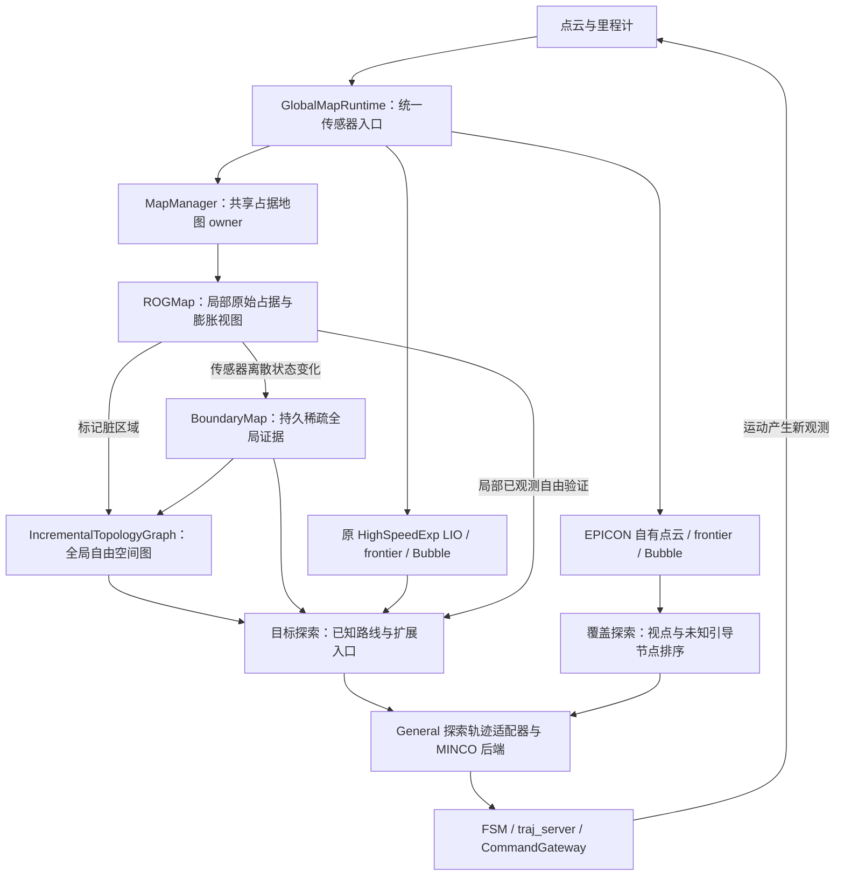

# 当前探索框架与 MapManager 协作

核对日期：2026-10-09。本文依据当前工作树源码与 release launch/YAML，描述组合式
`planner_runtime_node` 的实际调用链；不代表已验证正在运行的 release 二进制与源码完全一致。
历史 EPIC/FALCON 重构建议和早期 M1/M2 设计不能替代本文的模式与接口说明。

若需要先理解 coverage 如何从点云证据形成任务、如何执行并更新完成状态，请先读
[Coverage 点云探索完整任务流程](coverage_pointcloud_task_flow.md)，再查本文的地图接口与配置。

## 1. 当前有两条探索链

| 任务 | 前端与目标选择 | 地图协作 | 完成依据 |
| --- | --- | --- | --- |
| `target_exploration`，mission=`target` | 原 HighSpeedExp 的 frontier/Bubble 前端，加 `TargetRouteRuntime` 已知路线复用 | 读取共享全局拓扑、全局占据历史；执行段验证当前局部 ROG | 到达指定目标；没有有效推进时进入受限恢复或 BLOCKED |
| `exploration`，mission=`coverage` | 原生 EPICON 点云 frontier、Bubble 拓扑、未知区域引导与访问排序 | 自有点云几何驱动探索与执行；共享 ROG/BoundaryMap/全局拓扑同时积累 | 停稳后对新鲜点云进行多次无可执行前沿审计；持续无进展为 BLOCKED |

分支由 `FastExplorationFSM::usingEpicon()` 决定：有 EPICON frontend 且不是 target
模式时走 EPICON。组合入口以 `native_coverage=true` 初始化探索管理器，旧
`CoverageGuidanceManager` 不再创建；旧 coverage 参数和实现仍存在于源码中，但不是
该入口的覆盖主链，也不是 EPICON 失败后的回退链。

当前 [Unity release 入口](../general_planner_release/src/unity_planner_bridge/launch/unity_planner_release.launch)
默认 `initial_mode=state2state`、`exploration_mission_mode=target`、
`coverage_guidance_mode=off`。因此启动后处于普通点到点任务配置，启用 exploration
模块本身不表示已经开始覆盖探索。

## 2. 所有权与数据流

`GlobalMapRuntime` 创建一份 ROG、一个 owner `MapManager`、BoundaryMap 和全局拓扑维护器，
并把同一地图注入 navigation 与 exploration。tracking 使用同一占据证据上的独立膨胀查询
视图，不额外融合一份地图。`rog_map/ros_callback/enable=false` 避免 ROG 自行重复订阅融合。

需要区分两种拓扑：

- `MapManager::IncrementalTopologyGraph` 保存跨任务的自由空间连通性，是共享世界模型。
- 探索前端的 `TopoGraph`/Bubble 图服务视点接入、局部搜索和探索排序；EPICON 有自己的
  实例，target 链保留原 HighSpeedExp 实例。它们目前没有合并为同一张图。

全局拓扑在 exploration、navigation、HOLD 和任务交接期间持续维护。传感器回调只标记
脏区域，独立 worker 按预算消费机器人附近的区域；切换模式不清空世界地图。

主要入口：[组合初始化](../src/Planner/general_planner/Apps/planner_runtime_node_ros1.cpp)、
[传感器分发](../src/Planner/general_planner/src/general_core/planner_runtime/global_map_runtime.cpp)。

## 3. 覆盖探索：EPICON 前端与 General 轨迹后端

实际顺序如下：

1. `EpiconFrontend::ingestCloud()` 更新原生 LIO 点云结构，依据观测质量更新 frontier 簇，
   并记录实际经过位置。这里的前沿来自点云观测结构，不是直接调用
   `MapManager::getGlobalFrontiers()`。
2. `update()` 按新点云 revision 或审计请求更新 Bubble 骨架，结合历史位置与前沿包围盒
   生成未知区域引导点，并更新机器人接入节点。
3. 原生 `planGlobalPath()` 生成代表视点；历史里程计节点超过 10 个后加入未知引导节点。
   对有限候选进行连接检查、拓扑代价计算与 LKH 排序，候选池上限为 20。
   存在后续未知区域节点时，用它作为局部路线细化的出口。
4. 局部路径通过点云 Bubble 搜索生成，适配器在实际未来轨迹起点重新接入搜索，生成
   点云安全走廊，调用 General 的 `ExplorationCostManager` / `ExplorationTrajOpt`
   与 yaw 优化，再做动力学、碰撞和提交检查。
5. FSM 保持执行与重规划闭环，失败目标冷却后重选；完成要求停稳、新鲜且不同的点云
   帧以及多次完整前沿审计，不能把单次空候选或不可达等同于完成。

这里有一个必须保留的语义区别：覆盖模式的 `querySafetyState()` 按任务区域与
EPICON 点云净空返回 `KNOWN_FREE/OCCUPIED`。这个 `KNOWN_FREE` 表示点云几何满足
净空要求，**不等于 ROG 射线融合证明该体素已经观测为自由**。当前覆盖轨迹的安全检查
沿用这种点云几何语义；它尚未统一为 target 链的严格原始 ROG 已知自由语义。

当前覆盖任务处于 `PLAN_TRAJ/EXEC_TRAJ/CAUTION` 且已触发时，
`GlobalMapRuntime::cloudOdomCallback()` 先向 EPICON 分发点云，再更新共享 LIO，并按
`global_map/pointcloud_main_period` 节流共享 ROG 融合。Unity overlay 设置为 0.5 秒，
即输入充足时约 2 Hz；暂停、交接或其他任务恢复对每帧被接受点云的融合。
BoundaryMap 与全局拓扑的新增占据证据跟随这些实际融合帧。这里是同一传感器入口下
两种用途的地图表示，不是两个 ROG owner。

实现：[EPICON 前端](../src/Planner/general_planner/src/general_core/exploration/highspeed/epicon_frontend.cpp)、
[覆盖 FSM](../src/Planner/general_planner/src/general_core/exploration/highspeed/epicon_runtime.cpp)、
[轨迹与安全适配器](../src/Planner/general_planner/src/general_core/exploration/highspeed/general_planner_adapter.cpp)。

### 3.1 视点的位置和 yaw 怎样生成

前沿首先由点云观测质量产生。`FrontierManager` 将点云位置映射到三维稀疏 cell 标签，
结合观测距离、视野边缘、深度间隙及局部法向区分 `DENSE`、`SPARSE`、
`FRONTIER_DIS` 和 `FRONTIER_DIR`。`DENSE` 表示已获得足够观测的表面标签，不能将它
理解成飞行可穿过的自由体素。满足条件的稀疏 cell 在邻接 DENSE 时成为前沿，再聚成簇。

每轮按历史拓扑估算到簇的距离，普通规划只处理有限近邻簇，完整审计时扩大到全部有效簇。
对每个簇执行：

1. 以簇中心为原点，在多个高度、半径和周向角上进行柱形采样，候选位置为
   `cluster_center + [r*cos(theta), r*sin(theta), h]`。
2. 排除任务区域外、没有对应拓扑 region，以及到最近点云距离小于 0.9 m 的位置。
   这里 0.9 m 是当前 `initClusterViewpoints()` 的直接阈值，不是 ROG 膨胀半径。
3. 按点云净空形成的连接关系对候选分组，选代表接入 Bubble 图，删除没有拓扑连接或
   图搜索失败的组。
4. 对保留候选统计可见前沿：检查距离、观测方向/法向质量，并在稀疏标签上 raycast；
   遇到 `DENSE/SPARSE` 表面或越出任务区域就认为遮挡。
5. 对每个候选枚举 8 个 yaw，间隔 45°，起始偏移 22.5°；按雷达安装俯仰和垂直 FOV
   统计有效可见前沿数，取分数最高的 `(position, yaw)` 作为该簇代表。
   当前这段评分没有单独的水平 FOV 裁切；pitch 为零时，多个 yaw 的垂直视野计数可能
   相同，`max_element` 会取首个最大值，不能将结果理解成连续优化后的最优朝向。

原生默认柱形配置为 5 个高度层、6 个半径层、每圈 16 个点，约 480 个初始位置/簇；
高度范围参数为 -1.2～1.8 m，半径范围参数为 0.8～3.2 m，都是相对簇中心，采样循环
不包含上界。默认前沿 cell 为 0.4 m，普通 `local_tsp_size=20`。这些默认值来自
`configureNativeParameters()`，可由 `epicon/` 参数覆盖；父命名空间的同名旧前沿
参数不应自动视为原生 EPICON 的生效值。

实现：[前沿与视点评分](../src/Planner/general_planner/third_party/epicon/src/frontier_manager/frontier_manager.cpp)、
[簇选择与可达性筛选入口](../src/Planner/general_planner/third_party/epicon/src/frontier_manager/global_planning.cpp)。

### 3.2 未知区域怎样推断并参与访问顺序

未知引导使用几何近似，不扫描全局占据体素的 UNKNOWN：

1. 将任务空间分成三维 region；原生默认 region 大小为 5 × 5 × 4 m。
2. 把实际经过的位置存入所在 region，按 `sample_traj_point` 间距取样。
3. 对历史位置 `p` 计算 `d_occ`（最近点云距离），以及该 region 相交前沿簇包围盒
   中心到 `p` 的最小距离 `d_frontier`；令 `r=min(d_occ,d_frontier)`。
4. 半径达到阈值时构造轴对齐盒 `[p-r,p+r]`，从 region 盒中逐次扣除，留下若干小盒。
   这是探索进度近似：盒角可能在距离球之外，不能用这些盒证明自由空间或保证可见。
5. 删除小片段，将共享面的剩余盒聚成连通分量，对盒中心加权求代表点。
   权重和片段阈值由 `get_size()` 按各轴 0.4 m 离散计数计算，并不是实际存储了这些
   占据体素。没有满足相交条件的前沿时，region 会被标为 finished；这也不是逐体素
   完整观测认证。

历史里程计节点超过 10 个后，这些代表点作为 `is_unkownpoint_` 加入普通视点候选。
经过连接筛选后，从混合集合取欧氏距离较近的最多 20 个节点，构造拓扑路径代价矩阵，
用 LKH 求访问顺序。与未知节点有关的代价乘 `unknown_penalty_factor`（默认 1.5）；
当前从起点到未知节点的矩阵首行还会再乘一次，不能概括成所有边都只统一惩罚一次。

排序结果中的未知节点可以进入近期候选；较后面的未知节点会作为 `next_grid_node`
传给 `refineLocalTourHGrid()`。该函数用 Dijkstra 选择通往出口的局部候选路径，允许
跳过部分视点，并不强制访问所有候选。虽然还会计算 active-region 点，主混合池中加入
它们的语句目前被注释。

未知节点可能被选作近期目标，但仍需通过路径、点云净空、走廊和轨迹验证；这些验证
使用当前覆盖链的点云几何语义，不提供 ROG 原始已观测自由证明。

实现：[region 扣除与未知中心](../src/Planner/general_planner/third_party/epicon/src/pointcloud_topo/topo_skeleton_graph.cpp)、
[混合候选与局部路线细化](../src/Planner/general_planner/third_party/epicon/src/exploration_manager/fast_exploration_manager.cpp)。

### 3.3 “点云探索”是否意味着没有三维体素

| 结构 | 当前是否存在 | 是否为完整三态占据体素地图 |
| --- | --- | --- |
| EPICON 点云 ikd-tree | 是，保存几何并提供近邻距离 | 否 |
| EPICON 稀疏三维 frontier cell 标签 | 是，默认 0.4 m，用于观测质量与可见性 | 否，但属于三维空间离散 |
| region 分块、规则采样点与 octree | 是，用于 Bubble 构建和未知区域近似 | 否，但仍有三维分区和采样 |
| 点云降采样 `VoxelGrid` | 是，例如走廊障碍点采用 0.2 m 降采样 | 否，只是点云压缩 |
| 共享 ROGMap | 是，由 GlobalMapRuntime 继续融合 | 是，局部三维占据地图 |
| 全局 BoundaryMap | 是，保存边界证据 | 采用稀疏边界表示，不铺满全局体素数组 |

因此，EPICON 覆盖算法不需要额外构建一份完整三维占据图来产生视点和未知区域引导；
但“完全没有体素/网格结构”以及“整个运行时不再建三维地图”都不符合当前实现。
目标探索和 state2state 仍使用共享 ROG；是否删除或停建它属于另一个架构改动。

## 4. 目标探索：优先复用已知路线，局部前沿继续探路

当前 `target_exploration.yaml` 设置 `exploration/target_route/mode=prefer_known`。
`FastExplorationManager::prepareTargetRoute()` 提供两类查询：

- 全局：`topologySearchSnapshot()`、`worldEpoch()`、`peekGlobalGridType()`，用于查询和
  验证已知路线。当前局部原始占据证据优先，窗口外或窗口内尚未重新观测的位置可使用
  BoundaryMap 历史证据。
- 局部：`isObservedLocalKnownFree()`，要求位于当前 ROG 窗口、原始体素为
  `KNOWN_FREE`、不在膨胀障碍内，并满足净空、任务区域及启用时的 ESDF 检查。

路线策略优先寻找通往目标的已知路线；无法接到最终目标时，可以选择可达的拓扑扩展
入口。扩展入口必须具有自由侧接近证据，并检查出口方向确有未知空间：未连接的 region
portal 本身不能直接当作 frontier。没有可用路线时回到目标导向的局部 frontier/Bubble
选择，以目标距离、可达性等信息推进探索。

全局路线只贡献当前可执行的局部前缀。前缀逐段通过当前 ROG 已知自由检查，遇到未知或
窗口边界就截断并预留停止距离；当前 V2 前缀以静止端点结束，通过滚动重规划继续延伸。
BoundaryMap 的历史自由证据不能替代这一步局部执行验证。

实现：[路线接入](../src/Planner/general_planner/src/general_core/exploration/highspeed/fast_exploration_manager.cpp)、
[路线查询和截取](../src/Planner/general_planner/src/general_core/exploration/highspeed/target_route_runtime.cpp)、
[目标配置](../general_planner_release/src/general_planner_release/config/target_exploration.yaml)。

## 5. MapManager 提供什么，探索层负责什么

| 接口/数据 | 合适用途 | 边界 |
| --- | --- | --- |
| `getGridType()` / `getInfGridType()` / `insideLocalMap()` | 当前局部占据和碰撞检查 | 不自动用历史自由替代局部未知 |
| `getGlobalGridType()` / `peekGlobalGridType()` | 长距离占据证据、路线验证 | 原始占据查询，不是完整膨胀安全认证 |
| `getGlobalFrontiers()` | 持久地图自由/未知边界候选 | 当前主探索前端没有直接消费它；不包含视点评分和可执行性 |
| `topologySearchSnapshot()` | 只读全局图路线查询 | 图快照不可变，不意味着旁边的实时 ROG 查询也有快照语义 |
| `latestUpdate()` / `mapRevision()` | 融合版本与最近更新包围盒 | 最近一次更新不等于可重放的完整变化日志 |
| `worldEpoch()` | 世界切换时使缓存路线失效 | 与任务 epoch、点云 revision、拓扑 revision 分开使用 |

BoundaryMap 由传感器离散占据变化增量更新，每次重算变化体素及六邻域的边界状态。
滑动窗口清槽不是新的观测，不应擦除全局历史。探索层负责 frontier 聚类、视点/yaw、
任务排序、失败冷却和完成判定，MapManager 负责地图证据与全局连通性。

`peekGlobalGridType()` 当前要求在串行 world/map-owner 队列读取；不能因为拿到了
`SearchSnapshot` 就把其旁边的实时占据查询随意搬到新线程。进一步异步化需要专门的
占据快照或明确的同步协议。

## 6. 配置入口与后续整合方向

地图几何、融合、膨胀和全局拓扑由 launch 的 `map_config` 指向
[map.yaml](../general_planner_release/src/general_planner_release/config/map.yaml)。
当前 release 值包括：0.15 m 分辨率、72 × 72 × 8 m 局部窗口、导航/探索膨胀 3 格、
tracking 膨胀 1 格、`persistent_bubble_skeleton` 三维拓扑。覆盖 EPICON 的执行净空仍由
`DilateRadiusHard/Soft` 等点云参数决定，不能把 ROG 的“探索膨胀”注释理解成覆盖分支
正在按该膨胀地图执行。

探索算法和运动参数位于 `exploration_house.yaml`、`target_exploration.yaml` 及场景
overlay。release launch 依次载入基础探索、目标探索、场景 overlay、室内前沿、地图，
之后再写入 mission 等显式参数。当前
[Unity overlay](../general_planner_release/src/general_planner_release/config/exploration_unity_overlay.yaml)
的 `MaxVelMag=2.0` 与 state2state YAML 的 `traj_opt/boundary/max_vel=4.0`
属于不同规划配置；修改后者不会直接改变探索速度上限。

若后续要让覆盖探索更充分复用当前 MapManager，建议按以下边界整合；这些不是本文
已实现的改动：

1. 保留一个 ROG/BoundaryMap/全局拓扑 owner，让探索消费版本化证据；不在 EPICON 内
   新建共享占据地图，也不再注册或 drain ROG 状态变化回调。
2. 用全局 frontier/拓扑提供跨区域候选和已知连接；保留点云前端的视点、yaw、可见性与
   局部路径能力。全局节点或未知区域中心要转换成可验证的接近点后才能执行。
3. 若希望覆盖与 target 采用同一种“已观测自由”安全语义，需显式接入原始 ROG 局部
   前缀验证，并重新评估 0.5 秒融合节流、射线视野及地图新鲜度。当前点云距离判据不能
   直接改名当作观测证据；只改一个安全查询而保留全部前端假设也可能引入持续拒绝。
4. 用地图/任务/路线版本关联执行反馈，区分新障碍、未观测、优化失败与候选冷却；在
   实际运动和新增观测发生后更新任务进度，避免把规划成功或空候选当作覆盖完成。

本文仅进行了源码与配置核对，没有新增闭环实验或修改规划行为。
